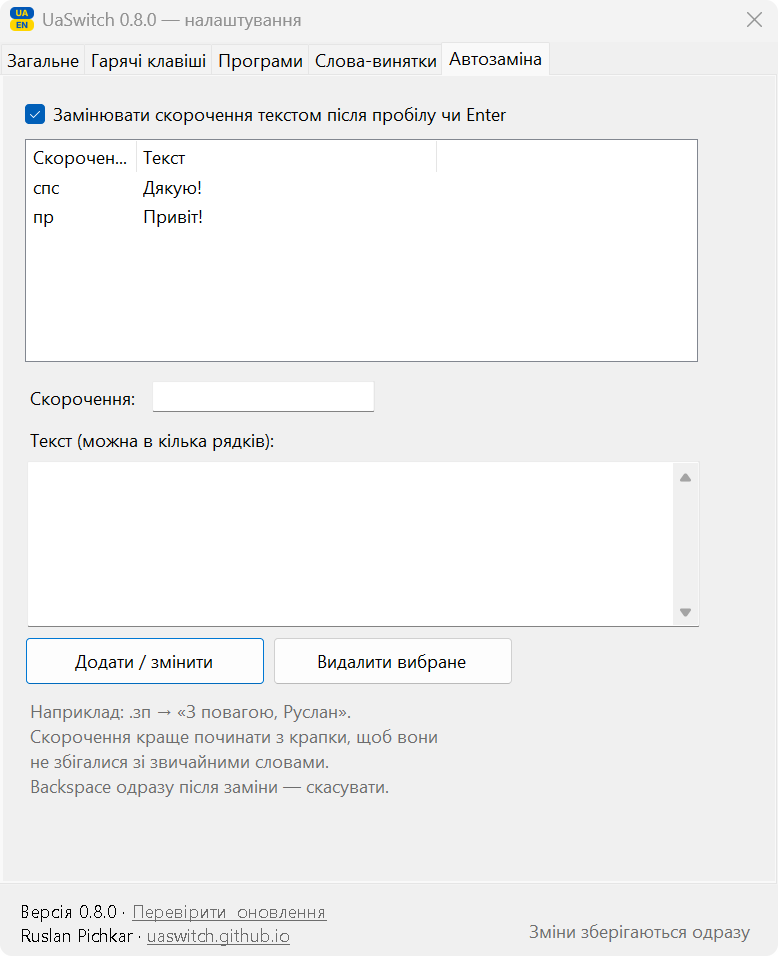
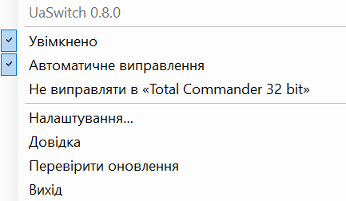

# UaSwitch — перемикач розкладок УКР/АНГЛ для Windows

**[⬇ Завантажити останню версію](../../releases/latest)** · **[сторінка програми](https://uaswitch.github.io/UaSwitch/)**

**Мінімалістичний, але повноцінний:** один файл менше 1 МБ, без встановлення й без інтернету — і при цьому автовиправлення розкладки, апострофи, коми, регістр і пробіли. Безкоштовно, відкритий код, без реклами.

Виправляє текст, набраний не в тій розкладці: `ghbdsn` → `привіт`, `руддщ` → `hello`.
Працює автоматично: слово, набране не в тій розкладці, виправляється після пробілу, і розкладка перемикається сама.

## Як це виглядає

Іконка біля годинника показує поточну розкладку (`UA` або `EN`), а при виправленні на мить стає зеленою:

Налаштування відкриваються подвійним клацанням по іконці. Кнопок «Зберегти» немає: кожна зміна діє одразу.

<table>
<tr>
<td align="center"> Загальне</td>
<td align="center"> Автозаміна</td>
</tr>
<tr>
<td align="center"> Гарячі клавіші</td>
<td align="center"> Програми</td>
</tr>
</table>

## Чим відрізняється від аналогів

**Мінімалізм**
- Один файл `UaSwitch.exe` менше 1 МБ. Без інсталятора: розпакував і запустив.
- Працює на вбудованому в Windows 10/11 .NET Framework 4.8, нічого докачувати не треба.
- Не виходить в інтернет без вашого дозволу: ні статистики, ні облікових записів. Перевірка нових версій — лише якщо ви її ввімкнете.
- Одне вікно налаштувань, зміни зберігаються одразу, кожна функція вимикається окремо.

**Функціональність**
- Виправляє розкладку автоматично, часто вже на 4-й літері, і враховує мову речення.
- Ставить апостроф (`мясо` → `м'ясо`) за повним словником української мови — у Word, Excel і браузері однаково.
- Ставить коми в українських реченнях, велику літеру на початку речення, виправляє Caps Lock і пропущений пробіл після коми.
- Автозаміна скорочень на ваш текст і перемикання мови клавішею Caps Lock.
- Не чіпає коди, номери, абревіатури, адреси й імена файлів.
- Будь-яке виправлення скасовується одним `Backspace`.

| | UaSwitch | Punto Switcher | Caramba Switcher | Klavko |
|---|---|---|---|---|
| Автовиправлення УКР ↔ АНГЛ | ✅ | ❌ лише RU ↔ EN | ❌ EN / RU / DE | ✅ |
| Відкритий код | ✅ ліцензія MIT | ❌ | ❌ | код відкритий, ліцензії немає |
| Розробник | Україна | Яндекс (під санкціями в Україні) | російський | Україна |
| Підхід | лише набір тексту | — | — | комбайн: голос, переклад, буфер обміну |

Klavko — сильний український проєкт для macOS з бета-версією для Windows, який вміє набагато більше. UaSwitch свідомо робить лише одне — набір тексту — і тому лишається крихітним і повністю офлайновим. Дані в таблиці — станом на листопад 2026.

## Запуск

1. Розпакуйте архів у постійну папку, наприклад `C:\Programs\UaSwitch\`.
2. Запустіть `UaSwitch.exe`. Встановлення не потрібне, програма працює на вбудованому в Windows 10/11 .NET Framework 4.8.
3. Щоб Windows не показувала попередження SmartScreen: права кнопка на `UaSwitch.exe` → «Властивості» → галочка «Розблокувати» → OK. Робиться один раз.
4. В області сповіщень (біля годинника) з'явиться іконка `UA` або `EN`. У Windows 11 нові іконки ховаються під стрілкою `^`, тож її варто перетягнути на панель.
5. У налаштуваннях увімкніть «Запускати разом з Windows».

**Оновлення:** меню іконки або посилання внизу налаштувань → «Перевірити оновлення» покаже, чи є нова версія і що в ній нового. Можна ввімкнути автоматичну перевірку раз на добу — галочка «Повідомляти про нові версії» на вкладці «Загальне» (за замовчуванням вимкнена). Новий `UaSwitch.exe` можна покласти замість старого або в іншу папку — автозапуск сам переналаштується на файл, з якого програму запустили востаннє. Не запускайте програму прямо з архіву: Windows розпаковує її в тимчасову папку, яку потім видаляє.

**Якщо не запускається разом з Windows:** перевірте, що у властивостях `UaSwitch.exe` (вкладка «Сумісність») не стоїть «Запускати від імені адміністратора» — такі програми Windows не запускає під час входу в систему. Права адміністратора програмі не потрібні.

У Windows мають бути додані обидві мови: українська та англійська.

## Автоматичний режим

- Набираєте `ghbdsn` + пробіл → стає `привіт `, розкладка перемикається на UA.
- Найчастіше слово виправляється ще під час набору, на 4-й літері: `ghbd` → `прив`, далі набираєте вже в правильній розкладці. Якщо початок неоднозначний, виправлення відбувається після пробілу.
- Однобуквене слово виправляється разом із наступним: `z ljvf` → `я вдома`.
- Кома перед підрядним: `знаю що` → `знаю, що`, `знаю де він` → `знаю, де він`, `місто в якому` → `місто, в якому`. Працює для «що», «щоб», «але», «бо», «якщо», «хоча», «ніби», «а», «який»/«котрий»/«чий» (усі форми) та інших. Не ставиться після сполучників, частинок і прийменників: «тому що», «для того щоб», «поки що», «такий як я» лишаються без коми. `Backspace` одразу після вставки прибирає кому.
- **Апостроф:** `мясо` → `м'ясо`, `обєкт` → `об'єкт`, `компютер` → `комп'ютер`, `мєясо` → `м'ясо` (натиснули «є», бо в англійській розкладці там апостроф), а зайвий прибирається: `св'ято` → `свято`. Перевірено на ~3 млн словоформ: правильні слова («бюро», «пюре», «буряк») не змінюються. Працює й у Word та Excel без жодних налаштувань Office.
- **Велика літера на початку речення:** `так. добре` → `так. Добре`. Не спрацьовує після скорочень (`вул.`, `грн.`, `т.д.`), ініціалів і трьох крапок. У Word, Excel і Outlook цю роботу лишаємо їхній власній автозаміні.
- Пропущений пробіл після коми: `Привіт,як` → `Привіт, як` (лише коли обидві частини — справжні слова, тож `file.txt` не чіпається).
- Враховує мову речення: серед українських слів `herb` стане «руки», а серед англійських лишиться як є. Короткі слова (`yt` → «не», `db` → «ви») розпізнаються за списком найуживаніших слів.
- **Автозаміна:** складіть список «скорочення → текст» (вкладка «Автозаміна»), наприклад `.дяк` → «Дякую за допомогу!». Скорочення замінюється після пробілу або Enter, спрацьовує навіть набране не в тій розкладці, а `Спс` дасть текст з великої. Текст може бути в кілька рядків.
- **Виправило не те?** Натисніть `Backspace` одразу після виправлення. Слово повернеться, і програма запам'ятає, що його не треба чіпати (меню → «Слова-винятки…»).
- Не чіпає: відомі слова поточної мови, слова з цифрами (`PB-2041`, `NCR-15`), адреси з `@`, абревіатури великими літерами (`PFMEA`, `AQAP`), якщо вони не є словом іншої мови, слова на кшталт `CamelCase`.
- Виправляє регістр: `пРИВІТ` → `Привіт` (і вимикає випадковий Caps Lock), `ПРивіт` → `Привіт`.
- Вимкнути в конкретній програмі: перейдіть у неї, потім права кнопка на іконці → «Не виправляти в «…»». За замовчуванням вимкнено в менеджерах паролів, віддаленому робочому столі й командних рядках.
- Вимкнути автоматику повністю: меню → «Автоматичне виправлення».
- При виправленні лунає тихий клік, а іконка на мить стає зеленою (можна вимкнути в налаштуваннях).

Деякі слова збігаються зі справжніми англійськими (`руки` = `herb`). Посеред українського речення програма їх виправляє, а на початку речення — ні; для таких випадків є ручні клавіші.

## Ручне виправлення

| Дія | Клавіші |
|---|---|
| Виправити останнє слово | `Pause` або двічі `Shift` |
| Повернути як було | ще раз ту саму комбінацію |
| Виправити виділений текст | виділити → `Shift+Pause` або двічі `Ctrl` |
| Перемкнути мову | `Caps Lock` (якщо ввімкнено на вкладці «Гарячі клавіші»); великі літери — `Shift + Caps Lock` |

Після виправлення розкладка перемикається автоматично, тож можна набирати далі.
Подвійний клік по іконці відкриває налаштування, права кнопка — меню.

## Налаштування

Вкладки: «Загальне» (автоматика, перемикання на 4-й літері, коми, пробіл після коми, регістр, велика літера на початку речення, апостроф, звук, підсвічування, автозапуск, журнал), «Гарячі клавіші», «Програми» (де не виправляти; можна вибрати з запущених), «Слова-винятки», «Автозаміна».

Зміни зберігаються й застосовуються одразу, кнопок «Зберегти» немає. Закрити вікно — хрестиком або `Esc`.

## Що варто знати

- Набраний текст ніде не зберігається (крім слів, які ви самі додали у винятки). У пам'яті лишається тільки поточне слово, і воно скидається після кліку мишею, Enter, стрілок чи переходу в інше вікно.
- Буфер обміну після виправлення виділеного тексту відновлюється.
- У вікнах, запущених від імені адміністратора, програма працює, лише якщо її теж запущено від адміністратора. Це обмеження Windows.
- Автозапуск — звичайний ярлик у папці «Автозавантаження» (його видно в Диспетчері завдань → «Автозавантаження»).
- Налаштування зберігаються в `%APPDATA%\UaSwitch\` (`settings.ini`, `exceptions.txt`, `autoreplace.txt`). Журнал `uaswitch.log` містить лише технічні події, без набраного тексту.

## Якщо антивірус попереджає

Деякі антивіруси (Microsoft Defender, Malwarebytes, 360) можуть помилково позначати UaSwitch як загрозу. Причина — сама природа перемикача розкладок: програма стежить за натисканнями клавіш, щоб виправити слово, і «набирає» виправлений текст. Так само працюють Punto Switcher та інші перемикачі, але їм антивіруси довіряють завдяки цифровому підпису й багаторічній репутації, а UaSwitch — нова програма без підпису.

- UaSwitch не зберігає й нікуди не передає набраний текст. В інтернет програма звертається лише для перевірки нової версії: коли ви натискаєте «Перевірити оновлення» або вмикаєте галочку «Повідомляти про нові версії» (за замовчуванням вимкнена). Це один запит до GitHub без жодних ваших даних.
- Код повністю відкритий: його можна переглянути в цьому репозиторії.
- Файли передано в Microsoft на перевірку як хибне спрацювання. Робота над цифровим підписом триває.

## Знайшли проблему?

Створіть звернення в розділі [Issues](../../issues): що набирали, що вийшло і в якій програмі.

## Ліцензії

Код програми — ліцензія MIT (файл `LICENSE`).

Частотні словники (`src/uk.txt.gz`, `src/en.txt.gz`) отримано з проєкту [wordfreq](https://github.com/rspeer/wordfreq) (Robyn Speer та ін.) і поширюються за ліцензією [CC BY-SA 4.0](https://creativecommons.org/licenses/by-sa/4.0/). Скрипт підготовки й калібрування: `src/model/build_model.py`.

Дані для апострофа (`src/apo.txt.gz`) отримано з українського словника hunspell проєкту spell-uk ([LibreOffice dictionaries](https://github.com/LibreOffice/dictionaries/tree/master/uk_UA)) і поширюються за ліцензією MPL 1.1. Скрипт: `src/model/build_apostrophe.py`.

## Розробник

Ruslan Pichkar. Ідеї та відгуки — у [Issues](../../issues).

## Збирання з коду

`src/build.sh` на Linux (.NET SDK + mono-devel) або Visual Studio / `csc` на Windows.
