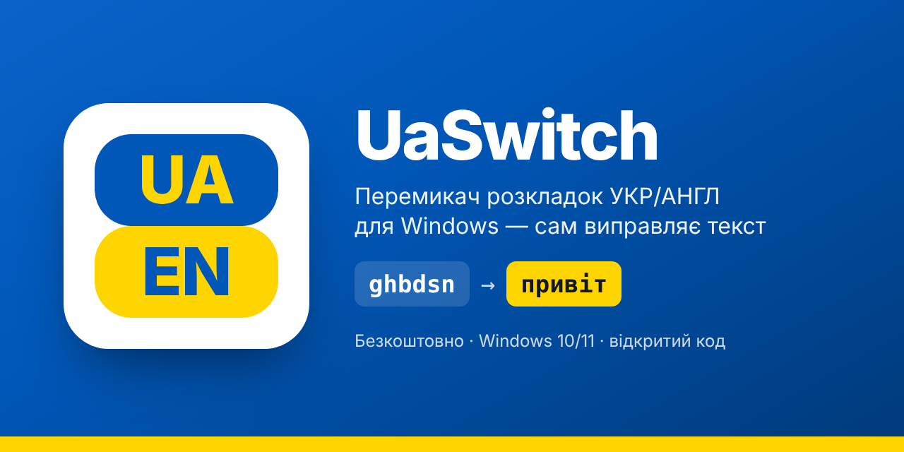
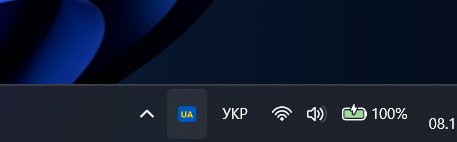
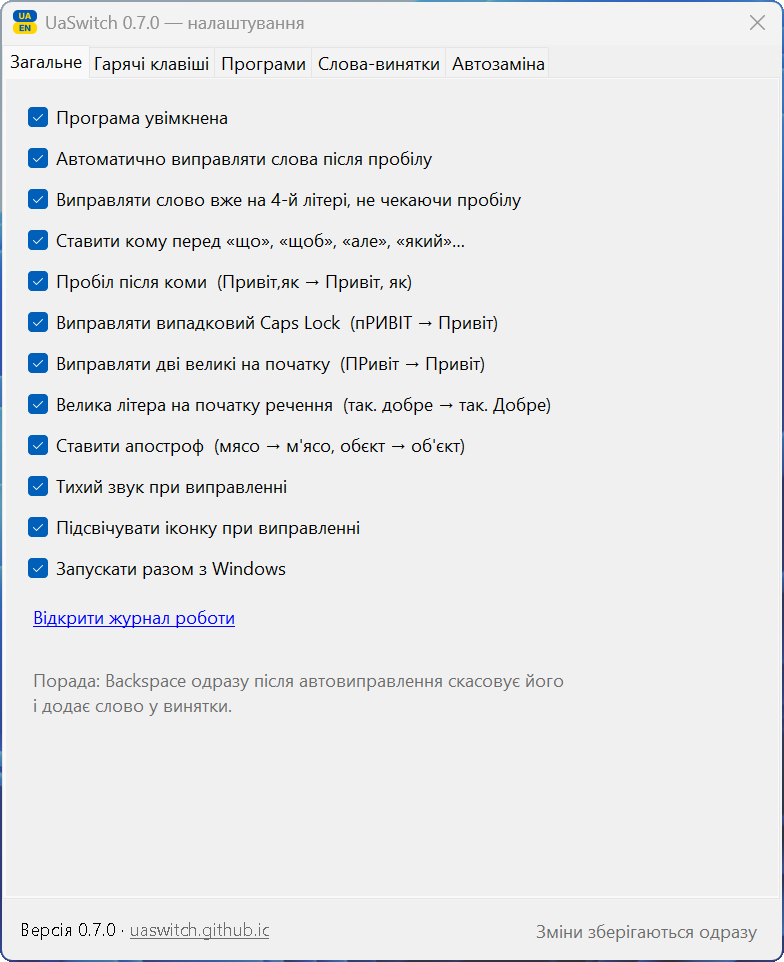
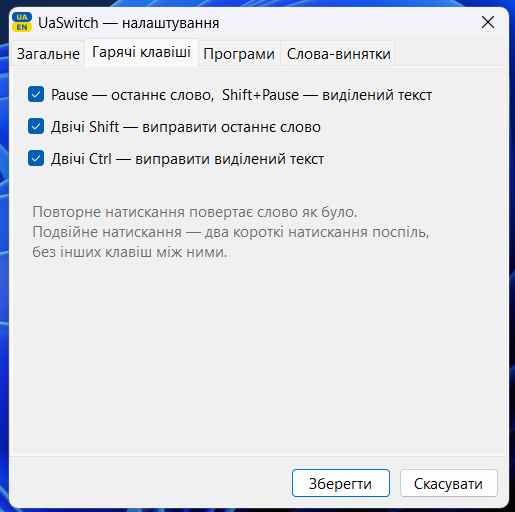
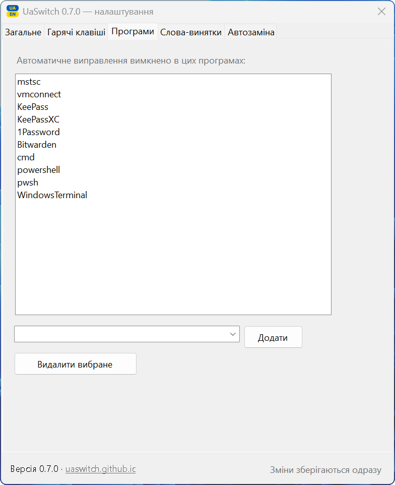

# UaSwitch — перемикач розкладок УКР/АНГЛ для Windows

**[⬇ Завантажити останню версію](../../releases/latest)** · безкоштовно · відкритий код · без реклами й без збору даних

Виправляє текст, набраний не в тій розкладці: `ghbdsn` → `привіт`, `руддщ` → `hello`.
Працює автоматично: слово, набране не в тій розкладці, виправляється після пробілу, і розкладка перемикається сама.

## Як це виглядає

Іконка біля годинника показує поточну розкладку (`UA` або `EN`), а при виправленні на мить стає зеленою:

Налаштування відкриваються подвійним клацанням по іконці:

<table>
<tr>
<td align="center"> Загальне</td>
<td align="center"> Гарячі клавіші</td>
<td align="center"> Програми</td>
</tr>
</table>

## Запуск

1. Розпакуйте архів у постійну папку, наприклад `C:\Programs\UaSwitch\`.
2. Запустіть `UaSwitch.exe`. Встановлення не потрібне, програма працює на вбудованому в Windows 10/11 .NET Framework 4.8.
3. Щоб Windows не показувала попередження SmartScreen: права кнопка на `UaSwitch.exe` → «Властивості» → галочка «Розблокувати» → OK. Робиться один раз.
4. В області сповіщень (біля годинника) з'явиться іконка `UA` або `EN`. У Windows 11 нові іконки ховаються під стрілкою `^`, тож її варто перетягнути на панель.
5. У меню іконки увімкніть «Запускати разом з Windows».

У Windows мають бути додані обидві мови: українська та англійська.

## Автоматичний режим

- Набираєте `ghbdsn` + пробіл → стає `привіт `, розкладка перемикається на UA.
- Найчастіше слово виправляється ще під час набору, на 4-й літері: `ghbd` → `прив`, далі набираєте вже в правильній розкладці. Якщо початок неоднозначний, виправлення відбувається після пробілу.
- Однобуквене слово виправляється разом із наступним: `z ljvf` → `я вдома`.
- Кома перед сполучником: `знаю що` → `знаю, що`. Працює для «що», «щоб», «але», «проте», «однак», «який»/«котрий» (усі форми). Не ставиться після сполучників, частинок і прийменників: «тому що», «для того щоб», «в якому», «поки що» лишаються без коми. `Backspace` одразу після вставки прибирає кому.
- **Виправило не те?** Натисніть `Backspace` одразу після виправлення. Слово повернеться, і програма запам'ятає, що його не треба чіпати (меню → «Слова-винятки…»).
- Не чіпає: відомі слова поточної мови, слова з цифрами (`PB-2041`, `NCR-15`), адреси з `@`, абревіатури великими літерами (`PFMEA`, `AQAP`), якщо вони не є словом іншої мови, слова на кшталт `CamelCase`.
- Виправляє регістр: `пРИВІТ` → `Привіт` (і вимикає випадковий Caps Lock), `ПРивіт` → `Привіт`.
- Вимкнути в конкретній програмі: перейдіть у неї, потім права кнопка на іконці → «Не виправляти в «…»». За замовчуванням вимкнено в менеджерах паролів, віддаленому робочому столі й командних рядках.
- Вимкнути автоматику повністю: меню → «Автоматичне виправлення».
- При виправленні лунає тихий клік, а іконка на мить стає зеленою (можна вимкнути в налаштуваннях).

Деякі короткі слова збігаються зі справжніми англійськими (`руки` = `herb`, `тис` = `nbc`). Такі програма свідомо не виправляє, для них є ручні клавіші.

## Ручне виправлення

| Дія | Клавіші |
|---|---|
| Виправити останнє слово | `Pause` або двічі `Shift` |
| Повернути як було | ще раз ту саму комбінацію |
| Виправити виділений текст | виділити → `Shift+Pause` або двічі `Ctrl` |

Після виправлення розкладка перемикається автоматично, тож можна набирати далі.
Подвійний клік по іконці відкриває налаштування, права кнопка — меню.

## Налаштування

Вкладки: «Загальне» (автоматика, перемикання на 4-й літері, коми, регістр, звук, підсвічування, автозапуск, журнал), «Гарячі клавіші», «Програми» (де не виправляти; можна вибрати з запущених), «Слова-винятки».

## Що варто знати

- Набраний текст ніде не зберігається (крім слів, які ви самі додали у винятки). У пам'яті лишається тільки поточне слово, і воно скидається після кліку мишею, Enter, стрілок чи переходу в інше вікно.
- Буфер обміну після виправлення виділеного тексту відновлюється.
- У вікнах, запущених від імені адміністратора, програма працює, лише якщо її теж запущено від адміністратора. Це обмеження Windows.
- Налаштування зберігаються в `%APPDATA%\UaSwitch\` (`settings.ini`, `exceptions.txt`). Журнал `uaswitch.log` містить лише технічні події, без набраного тексту.

## Знайшли проблему?

Створіть звернення в розділі [Issues](../../issues): що набирали, що вийшло і в якій програмі.

## Ліцензії

Код програми — ліцензія MIT (файл `LICENSE`).

Частотні словники (`src/uk.txt.gz`, `src/en.txt.gz`) отримано з проєкту [wordfreq](https://github.com/rspeer/wordfreq) (Robyn Speer та ін.) і поширюються за ліцензією [CC BY-SA 4.0](https://creativecommons.org/licenses/by-sa/4.0/). Скрипт підготовки й калібрування: `src/model/build_model.py`.

## Збирання з коду

`src/build.sh` на Linux (.NET SDK + mono-devel) або Visual Studio / `csc` на Windows.
